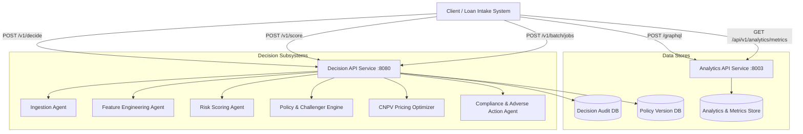

# HelixDecision API Reference & OpenAPI Specification

Welcome to the **HelixDecision API Reference Guide**. This document provides developer documentation for integrating with the HelixDecision Credit Risk & Decisioning Platform.

---

## 1. Overview & Service Architecture

HelixDecision exposes high-performance microservice endpoints for decisioning, scoring, analytics, and compliance.



### Core Services:
* **Decision API** (`http://localhost:8080`): Primary entry point for real-time application decisioning, scoring, batch jobs, referral queue review, and policy waivers.
* **Analytics API** (`http://localhost:8003`): Serves system performance metrics, population stability index (PSI) drift reports, model health, and GraphQL semantic queries.

---

## 2. Authentication & Headers

All API requests require valid API keys or JWT bearer tokens.

### Request Headers
| Header Name | Type | Required | Description | Example |
| :--- | :--- | :--- | :--- | :--- |
| `X-API-Key` | String | Yes | System API key for authenticating requests. | `dev-key-12345` |
| `X-Tenant-ID` | String | Yes | Tenant partition identifier. | `lending_club` |
| `X-Correlation-ID` | String | Optional | Request correlation UUID for end-to-end tracing. | `c839a941-89fa-49df` |
| `Content-Type` | String | Yes | Content payload format. | `application/json` |

---

## 3. Decision API Endpoints (`:8080`)

### 3.1 Real-Time Decision Pipeline (`POST /v1/decide`)

Executes the multi-agent pipeline: data intake, feature extraction, risk scoring, policy evaluation (champion/challenger), continuous pricing optimization, and explainability logging.

#### Request Payload Schema
```json
{
  "applicant_id": "APP-998241",
  "tenant_id": "lending_club",
  "product_type": "PERSONAL_LOAN",
  "requested_amount": 15000.0,
  "stated_annual_income": 85000.0,
  "credit_score": 680,
  "debt_to_income_ratio": 0.28,
  "revolving_utilization": 0.42,
  "delinquencies_2yrs": 0,
  "derogatory_recs": 0,
  "open_credit_lines": 8,
  "employment_status": "EMPLOYED",
  "bank_enrichment": {
    "account_age_days": 720,
    "avg_monthly_deposit": 7083.33,
    "nsf_count_90d": 0
  }
}
```

#### Response Payload Schema (`200 OK`)
```json
{
  "application_id": "APP-998241",
  "decision": "APPROVED",
  "recommended_apr": 0.1425,
  "recommended_credit_limit": 15000.0,
  "probability_of_default": 0.0245,
  "expected_loss": 312.38,
  "expected_cnpv": 1420.50,
  "policy_evaluated": {
    "policy_version": "v2.4.0",
    "role": "CHAMPION",
    "is_shadow": false
  },
  "top_adverse_factors": [
    {
      "code": "REVOLVING_UTILIZATION_HIGH",
      "description": "Revolving line utilization exceeds preferred target threshold",
      "importance_score": 0.18
    }
  ],
  "audit_hash": "SHA256-e3b0c44298fc1c149afbf4c8996fb92427ae41e4649b934ca495991b7852b855",
  "timestamp": "2026-09-24T20:15:00Z"
}
```

---

### 3.2 Pure Risk & Fraud Scoring (`POST /v1/score`)

Scores applicant credit risk and fraud likelihood without triggering full policy or pricing rules.

#### Curl Example
```bash
curl -X POST http://localhost:8080/v1/score \
  -H "X-API-Key: dev-key-12345" \
  -H "X-Tenant-ID: lending_club" \
  -H "Content-Type: application/json" \
  -d '{
    "applicant_id": "APP-11029",
    "credit_score": 720,
    "annual_income": 95000.0,
    "dti": 0.22
  }'
```

#### Response Payload Schema (`200 OK`)
```json
{
  "applicant_id": "APP-11029",
  "pd_score": 0.0182,
  "risk_tier": "TIER_1_LOW_RISK",
  "fraud_score": 0.005,
  "thin_file_used": false
}
```

---

### 3.3 Asynchronous Batch Decisioning (`POST /v1/batch/jobs`)

Submits bulk loan applications for asynchronous background batch processing.

#### Request Payload (`multipart/form-data`)
* `file`: CSV file containing application records (`loan_applications.csv`).
* `tenant_id`: `lending_club`

#### Response (`202 Accepted`)
```json
{
  "job_id": "job_batch_8849201a",
  "status": "QUEUED",
  "total_records": 5000,
  "created_at": "2026-09-24T20:15:00Z"
}
```

---

### 3.4 Manual Underwriting Referral Queue (`GET /v1/referrals`)

Fetches applications referred for Human-in-the-Loop (HITL) credit analyst review.

#### Query Parameters
* `status`: `PENDING` | `APPROVED` | `DECLINED` (Default: `PENDING`)
* `limit`: `50`

#### Response (`200 OK`)
```json
{
  "referrals": [
    {
      "referral_id": "REF-5021",
      "application_id": "APP-998242",
      "referral_reason": "DTI_BORDERLINE_MANUAL_REVIEW",
      "pd_score": 0.058,
      "stated_annual_income": 62000.0,
      "created_at": "2026-09-24T19:30:00Z"
    }
  ],
  "total_count": 1
}
```

---

## 4. Analytics API Endpoints (`:8003`)

### 4.1 System Metrics & SLA Telemetry (`GET /api/v1/analytics/metrics`)

Returns real-time decision throughput, approval distribution, and p99 latency stats.

#### Response Schema (`200 OK`)
```json
{
  "throughput_req_per_sec": 142.5,
  "p95_latency_ms": 18.4,
  "p99_latency_ms": 34.2,
  "approval_rate_24h": 0.648,
  "decline_rate_24h": 0.282,
  "referral_rate_24h": 0.070,
  "five_xx_error_rate": 0.0002
}
```

---

### 4.2 Population Stability Index & Drift (`GET /api/v1/analytics/drift`)

Retrieves Kolmogorov-Smirnov and PSI feature drift metrics across active scoring models.

#### Response Schema (`200 OK`)
```json
{
  "model_id": "cc_pd_v2",
  "evaluation_period": "LAST_30_DAYS",
  "overall_psi": 0.042,
  "status": "STABLE",
  "feature_drift": [
    { "feature": "revolving_utilization", "psi": 0.015, "status": "STABLE" },
    { "feature": "debt_to_income_ratio", "psi": 0.068, "status": "MODERATE_DRIFT" }
  ]
}
```

---

## 5. Standard Error Schemas

The platform adheres to standardized HTTP status codes and structured error responses.

#### Error Response Format
```json
{
  "error_code": "INVALID_INPUT_SCHEMA",
  "message": "Field 'stated_annual_income' must be a positive float.",
  "details": [
    {
      "loc": ["body", "stated_annual_income"],
      "msg": "value is not a valid float",
      "type": "type_error.float"
    }
  ],
  "correlation_id": "c839a941-89fa-49df",
  "timestamp": "2026-09-24T20:15:00Z"
}
```

### Common HTTP Status Codes
* `200 OK`: Request succeeded.
* `202 Accepted`: Asynchronous batch job queued.
* `400 Bad Request`: Validation failure or missing mandatory payload parameters.
* `401 Unauthorized`: Invalid or missing `X-API-Key` or Bearer token.
* `403 Forbidden`: Tenant mismatch or insufficient authorization permissions.
* `422 Unprocessable Entity`: Data schema constraint breach.
* `500 Internal Server Error`: Pipeline exception; check server logs with `X-Correlation-ID`.
