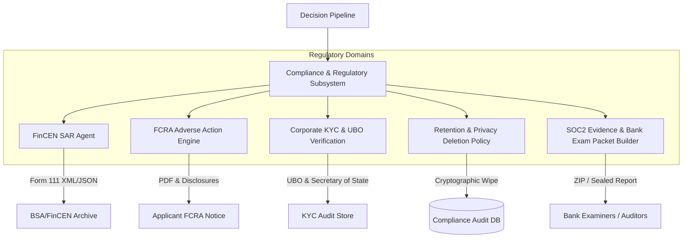

# Regulatory Compliance, Adverse Action & BSA/FinCEN Operations Guide

Welcome to the **HelixDecision Regulatory Compliance & Governance Guide**. This document details the compliance architecture, regulatory controls, automated BSA/FinCEN filing mechanisms, FCRA adverse action generation, and bank examination audit readiness built into the platform.

---

## 1. Compliance Architecture Overview

HelixDecision enforces automated, auditable compliance controls across five regulatory domains:



### Supported Regulatory Frameworks
* **Fair Credit Reporting Act (FCRA)** & **Equal Credit Opportunity Act (ECOA / Reg B)**: Mandatory principal denial reason extraction, credit score disclosures, and PDF notice generation.
* **Bank Secrecy Act (BSA) & FinCEN**: Automated Suspicious Activity Report (SAR Form 111) drafting for push payment fraud, mule accounts, and structured transactions.
* **Corporate KYC & CIP**: Beneficial Ownership (UBO) extraction, Secretary of State business registry verification, and financial statement validation.
* **SOC 2 Type II & Bank Examination**: Immutable audit logs, RBAC enforcement, and automated exam packet collation.

---

## 2. FinCEN Suspicious Activity Report (SAR) Agent (`compliance/fincen_sar_agent.py`)

The `FinCENSARAgent` monitors streaming transaction telemetry, identifying patterns that breach BSA filing thresholds, and automatically drafts FinCEN Form 111 (SAR-DI) filing packages.

### Automated Detection Patterns
1. **`APP_PUSH_PAYMENT_SCAM`**: High-velocity outward transfers immediately following account credential or device changes.
2. **`MULE_ACCOUNT_CLUSTER`**: Rapid fan-in and fan-out transfers across linked account clusters.
3. **`HIGH_VELOCITY_SUSPICIOUS_TRANSFERS`**: Rapid sequence transfers designed to evade single-transaction reporting limits.

### Python Code Example
```python
from compliance.fincen_sar_agent import FinCENSARAgent

sar_agent = FinCENSARAgent(filing_institution_id="HELIX_FINANCIAL_INC")

subject_data = {
    "name": "Acme Capital LLC",
    "tax_id": "XX-XXX9821",
    "address": "450 Lexington Ave",
    "city": "New York",
    "state": "NY",
    "zip_code": "10017",
    "phone": "212-555-0199"
}

flagged_txs = [
    {"transaction_id": "TX-99101", "amount": 9800.00, "timestamp": "2026-09-24T14:10:00Z"},
    {"transaction_id": "TX-99102", "amount": 9950.00, "timestamp": "2026-09-24T14:15:00Z"}
]

# Draft SAR Filing Package
sar_package = sar_agent.draft_sar_filing(
    subject_data=subject_data,
    flagged_transactions=flagged_txs,
    fraud_result=type("FraudResult", (), {"app_scam_flag": False, "mule_cluster_flag": True})()
)

print(f"Tracking ID: {sar_package.sar_tracking_id}")
print(f"Audit Hash: {sar_package.audit_hash}")
print(f"Narrative:\n{sar_package.activity_detail.narrative_summary}")
```

---

## 3. FCRA Adverse Action Generator (`compliance/adverse_action.py`)

Under FCRA and ECOA (Reg B), declined applicants must receive an Adverse Action Notice detailing the top principal reasons for adverse decisioning within 30 days.

### Adverse Action Flow
1. **Explainability SHAP Extraction**: `ExplainabilityAgent` extracts negative SHAP feature contributions.
2. **FCRA Code Mapping**: Maps raw features (e.g. `revolving_utilization_ratio`) to standardized FCRA reason codes (e.g. `CODE_28: High Revolving Credit Utilization`).
3. **Notice & PDF Generation**: Generates compliant text disclosures and downloadable PDF notices.

#### Sample FCRA Notice JSON Payload
```json
{
  "application_id": "APP-998243",
  "applicant_name": "Jane Doe",
  "decision": "DECLINED",
  "credit_score_used": 590,
  "credit_score_source": "Equifax Commercial Risk Index",
  "principal_reasons": [
    {
      "rank": 1,
      "code": "FCRA_REASON_28",
      "text": "Proportion of balance to high credit on revolving accounts is too high."
    },
    {
      "rank": 2,
      "code": "FCRA_REASON_14",
      "text": "Length of time accounts have been established is insufficient."
    }
  ],
  "disclosures": {
    "ecoa_statement": "The Federal Equal Credit Opportunity Act prohibits creditors from discriminating against credit applicants...",
    "bureau_contact": "Equifax Information Services LLC, P.O. Box 740241, Atlanta, GA 30374, (800) 685-1111"
  }
}
```

---

## 4. Corporate KYC & Beneficial Ownership Engine (`compliance/corporate_kyc_engine.py`)

For business and commercial loan applications, the Corporate KYC engine verifies entity legitimacy and checks Ultimate Beneficial Ownership (UBO) against OFAC Sanctions lists.

### Primary Verification Checks
* **Secretary of State (SoS) Registry Status**: Confirms active legal standing and state incorporation date.
* **UBO Ownership Threshold**: Identifies individuals owning $ \ge 25\% $ equity.
* **OFAC / PEP Screening**: Runs fuzzy name matching against SDN (Specially Designated Nationals) watchlists.

---

## 5. Data Retention & Privacy Erasure (`compliance/retention_policy.py`)

Enforces regulatory retention schedules while supporting GDPR/CCPA "Right-to-be-Forgotten" erasure requests.

| Record Type | Minimum Retention Period | Governing Regulation | Erasure Restriction |
| :--- | :--- | :--- | :--- |
| Adverse Action Notices | 25 Months | ECOA / Regulation B | Locked against deletion until period expires |
| Approved Credit Applications | 7 Years | BSA / Internal Revenue Code | Locked during loan lifecycle |
| Operational Telemetry Logs | 90 Days | SOC 2 Type II | Wiped automatically post-expiry |
| Marketing Inquiries | Immediate upon request | GDPR / CCPA | Soft deleted within 30 days |

---

## 6. Bank Examination Packet Store (`compliance/exam_packet_builder.py`)

`ExamPacketBuilder` aggregates decision audit trails, model validation reports, committee approval minutes, and policy challenger metrics into a sealed ZIP/PDF bundle for regulatory examiners (OCC, FDIC, CFPB).

### CLI Command to Build Exam Packet
```bash
python -m compliance.exam_packet_builder \
  --tenant lending_club \
  --period 2026-Q1 \
  --output /tmp/exam_packets/2026_Q1_LendingClub_Exam_Packet.zip
```
